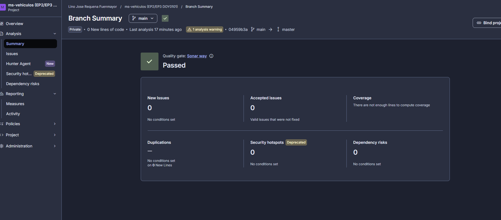
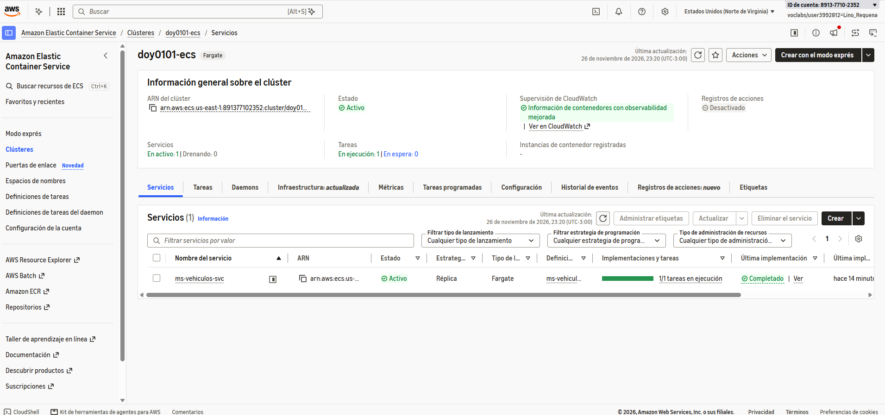
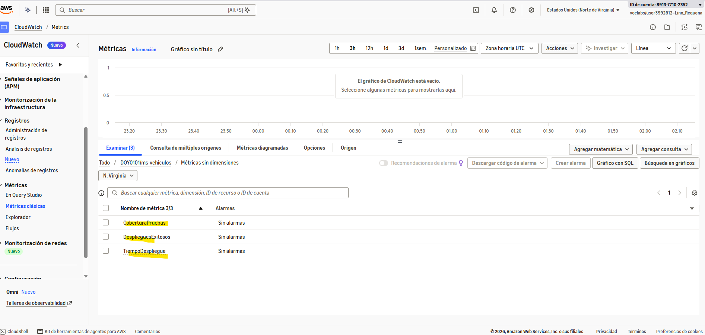
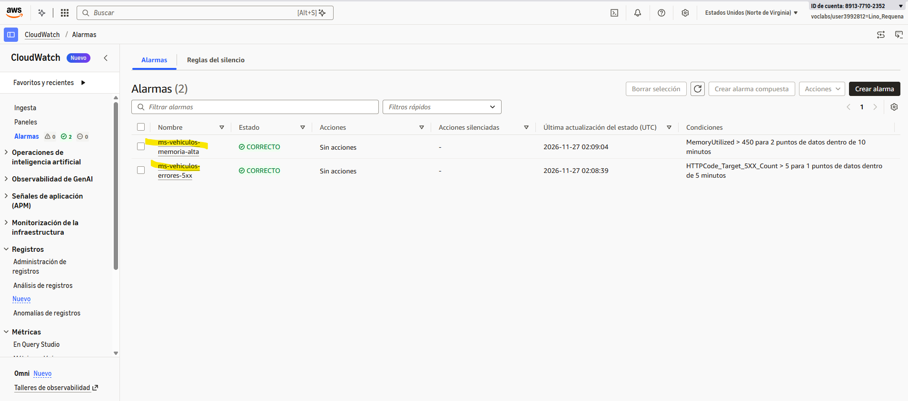
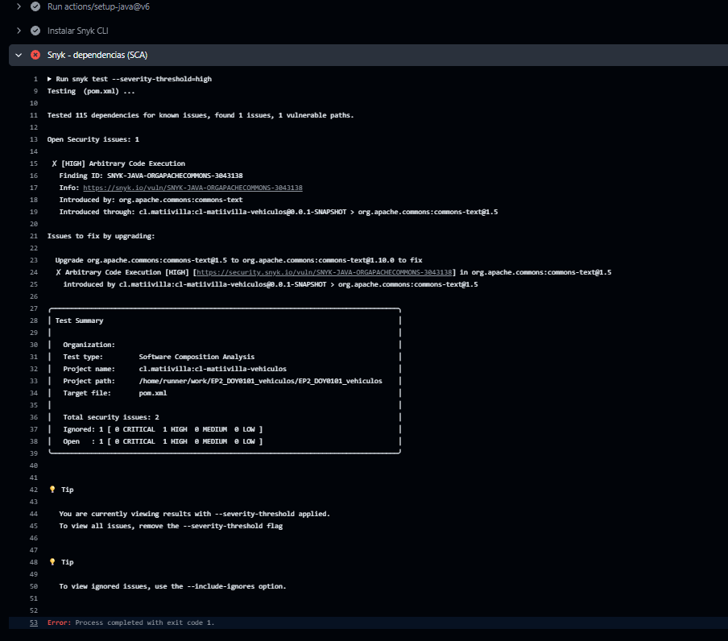
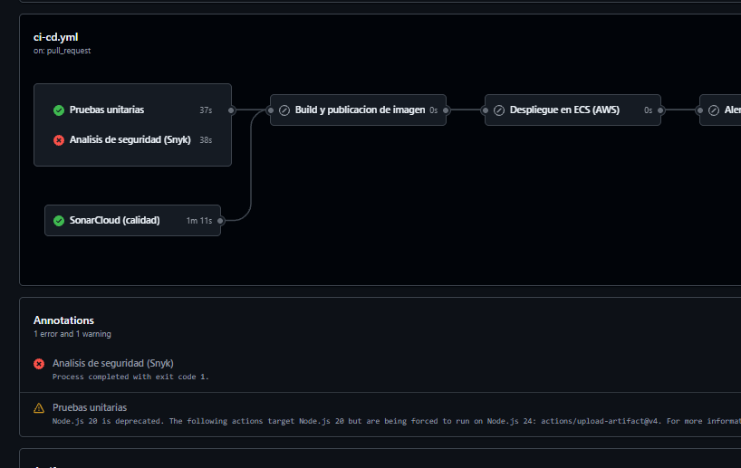
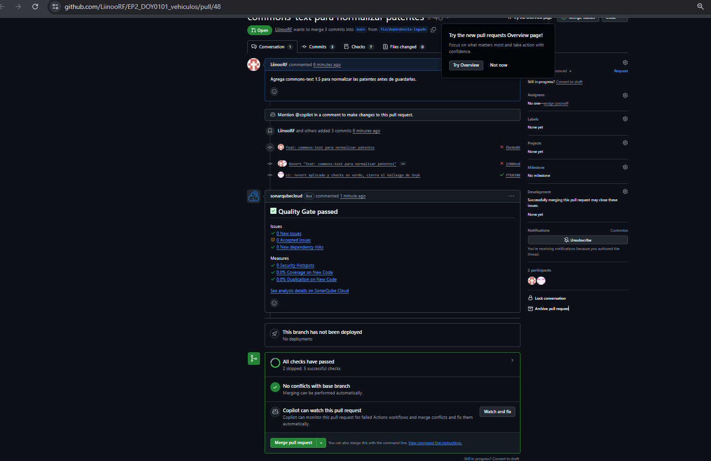

# EP3 — Observabilidad del ms-vehiculos

La Evaluación Parcial 3 extiende el pipeline de la EP2 con monitoreo, dashboards y politicas
de cumplimiento. Este documento cubre lo que se agrego sobre lo que ya documentamos en el
README principal. Integrantes: Lino Requena y Arion Ruiz-Tagle.

## Que se agrego al pipeline

El workflow (`ci-cd.yml`) tenia 5 jobs y ahora tiene 6:

| Job | Que hace |
|---|---|
| test | JUnit + JaCoCo con puerta de 70% de lineas (de la EP2) |
| **sonar** | `mvnw verify` + scanner de SonarCloud con quality gate. Si no pasa, el PR no se mergea |
| security | Snyk SCA + SAST con umbral high (de la EP2) |
| build-image | Trivy sobre la imagen y push a GHCR (de la EP2) |
| deploy-ecs | Registra la task definition, crea/actualiza el servicio en ECS Fargate y espera estabilidad |
| alert | Abre un issue si algo falla en main (de la EP2) |

El job de SonarCloud corre el analisis con:

```yaml
./mvnw -B org.sonarsource.scanner.maven:sonar-maven-plugin:sonar
  -Dsonar.projectKey=kawyyz_EP2_DOY0101_vehiculos
  -Dsonar.organization=liinoorf
  -Dsonar.host.url=https://sonarcloud.io
  -Dsonar.coverage.jacoco.xmlReportPaths=target/site/jacoco/jacoco.xml
```

El token va por secret (`SONAR_TOKEN`), nunca en el pom. El branch protection de main
(heredado de la EP2) exige que el quality gate pase antes del merge.



## Despliegue en ECS Fargate

Cambiamos el destino del despliegue: antes era SSH a un servidor, ahora el job `deploy-ecs`
entra a AWS con credenciales del Learner Lab (secrets `AWS_*` que se refrescan en cada sesion
del lab) y hace:

1. `envsubst` sobre `ecs/task-definition.json` con la imagen del commit y el rol LabRole
2. `register-task-definition` con esa revision
3. Si el servicio `ms-vehiculos-svc` no existe, lo crea (subredes default, SG con el 9004
   abierto, IP publica); si existe, `update-service` con la revision nueva
4. Circuit breaker con rollback automatico activado
5. `wait services-stable` y verificacion de que la imagen desplegada es exactamente la del commit



Porque el servicio se crea solo, el pipeline funciona igual en un lab recien limpiado:
no hay paso manual de infraestructura. La imagen viene de GHCR, el servidor nunca compila.

## Metricas del despliegue en CloudWatch

El paso final del deploy publica tres metricas custom en el namespace `DOY0101/ms-vehiculos`:

| Metrica | Que es |
|---|---|
| `TiempoDespliegue` | Segundos que duro el deploy (del inicio del job a la estabilizacion) |
| `CoberturaPruebas` | Porcentaje de lineas cubiertas, leido del `jacoco.csv` que viaja como artifact del job de test |
| `DesplieguesExitosos` | Contador de despliegues que llegaron a COMPLETED |

Son metricas del pipeline, no de la aplicacion: miden el proceso CI/CD, que es lo que pide
el IE3 (tiempo de despliegue y cobertura junto a CPU/memoria y errores).



## Monitoreo del servicio

Las metricas de la aplicacion tambien llegan a CloudWatch por dos caminos:

- **Logs**: el contenedor escribe en `/ecs/ms-vehiculos` (awslogs).
- **Container Insights**: CPU, memoria, tareas y red por servicio en `ECS/ContainerInsights`.

Ademas el deploy deja dos alarmas listas (se crean o actualizan en cada corrida):

| Alarma | Condicion |
|---|---|
| `ms-vehiculos-errores-5xx` | Mas de 5 errores 5XX en 5 minutos |
| `ms-vehiculos-memoria-alta` | Memoria promedio sobre 450 MB durante 10 minutos (la tarea tiene 512 MB) |



Con la exposicion de `/actuator/metrics` y `/actuator/prometheus` (agregada en la rama de
observabilidad) la app publica sus propias metricas etiquetadas con el commit, asi cualquier
alarma se puede rastrear hasta el codigo exacto que la provoco.

## Politicas de cumplimiento

Resumen de las puertas que tiene el pipeline hoy:

| Puerta | Donde | Que bloquea |
|---|---|---|
| Cobertura minima 70% | pom.xml (JaCoCo check) | builds sin cobertura suficiente |
| Sonar way quality gate | job sonar | codigo nuevo con issues, sin cobertura o con duplicacion |
| Snyk SCA/SAST high | job security | dependencias o codigo con hallazgos high/critical |
| Trivy CRITICAL/HIGH | job build-image | imagenes con vulnerabilidades sin parchar |
| Branch protection | ruleset de main | merges sin los checks en verde |
| Circuit breaker ECS | job deploy-ecs | despliegues que no pasan el healthcheck (revierte solo) |

## Demostracion: el pipeline se detiene ante una falla critica

Se agrego commons-text 1.5 (dependencia con CVE alto conocido) en un PR. Snyk lo detecto
en el job de seguridad y el pipeline se detuvo: el build y el deploy ni siquiera comenzaron.

El hallazgo: `Arbitrary Code Execution [HIGH]` en `commons-text@1.5`
(SNYK-JAVA-ORGAPACHECOMMONS-3043138), sobre 115 dependencias analizadas.





El revert devolvio el pom al estado anterior y el mismo PR quedo con todos los checks en
verde: la puerta de seguridad funciona y ademas permite recuperarse rapido.



## Como lo usamos para decidir

Un ejemplo concreto de este sprint: el hallazgo HIGH de Snyk por Spring Boot 4.1.2 salio en
el pipeline, lo vimos como PR bloqueado de Dependabot, subimos a 4.1.3 y el pipeline volvio
a verde. Sin la puerta de Snyk ese bump no habria pasado nunca porque nadie lo revisaba a mano.

Otro: el W7 de la plantilla nos mostro que una metrica puede existir y un widget quedar vacio
por la estadistica equivocada (Sum sobre una metrica de promedio). Ese mismo criterio lo
aplicamos aca: `TiempoDespliegue` se publica en segundos y se consulta con estadistica
Maximum, no Average, porque cada despliegue es un evento, no una serie continua.

## Problemas que tuvimos en esta entrega

- **Los secrets del Learner Lab vencen en cada sesion.** El deploy fallaba con
  "security token expired" hasta que lo refrescamos. Es la contrapartida de usar un lab
  academico: las credenciales no duran.
- **El LabRole no permite crear namespaces de Cloud Map.** La policy del lab niega
  `servicediscovery:*`, asi que no pudimos usar Service Connect con Private DNS para los
  tres servicios de la plantilla; se resolvio dejando que ECS creara el namespace via los
  defaults del cluster.
- **El lab bloquea `sg-*` como nombre de security group.** El instructivo pedia
  `sg-microservicios` y el API lo rechaza; se uso `microservicios-sg-doy0101`.
- **`update-service` falla en un lab limpio** porque el servicio no existe todavia. El job
  de deploy ahora pregunta primero y crea el servicio si falta.
- **El shorthand de `--network-configuration` con comillas** rompe el parser de la CLI;
  lo pasamos a JSON por archivo.
